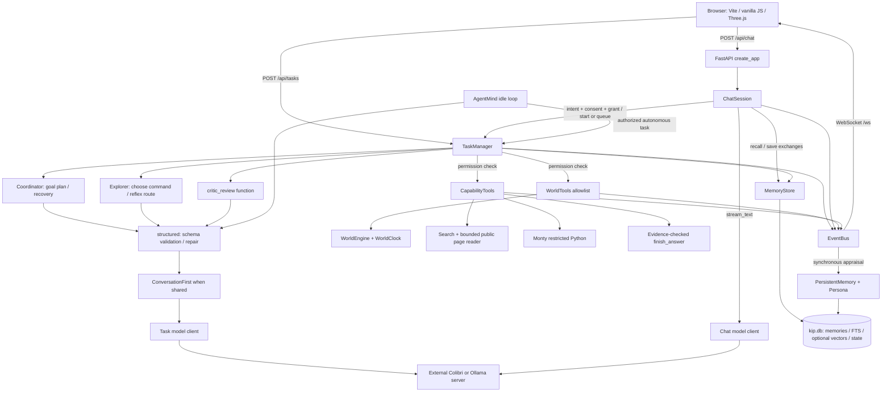

# Kip / Agentic Playground: grounded architecture map

## Implemented migration: 31 October 2026

This section supersedes the relevant baseline findings below. The remainder is the
original source-verified architecture inspection, with pre-migration line numbers.
See `KIP_IMPLEMENTATION_PLAN.md` for acceptance results, commands and remaining phases.

- `memory/recall.py` adds an append-only SQLite conversation transcript with unique
  session/turn IDs. `main.py` supplies stable `CHAT_SESSION_ID` (default `home`);
  `ChatSession` rehydrates 200 recent turns and journals each turn before publishing.
  Offers and queued actions are not restored. This is a persistence foundation, not
  multi-client isolation: public routes, memory retrieval, world and manager remain shared.
- `chat/context.py` replaces eight clipped turns with budgeted whole turns and exact
  older excerpts ranked by relevance/recency, favoring corrections and commitments.
  `CHAT_CONTEXT_TOKENS` defaults to 6,000 and also respects context capacity minus
  reserved generation. UTF-8 byte counting is deliberately conservative and labeled
  as an estimate; a tokenizer callback is supported. Required context is never silently
  clipped. Full transcript storage and existing memory retrieval supplement the window.
- Turns carry `content`, `screen_text`, `spoken_text`, and `session_id`; legacy `text`
  remains spoken text. Frontend uses canonical text with preserved whitespace and no
  unsafe HTML. Code, tables and links survive in screen content. Voice turns tables into
  labeled rows. Markdown headings/fenced code no longer masquerade as action trailers.
- Task identity retains recipients, ownership, direction, timing, numeric punctuation
  and distinct negations. Offer-ID binding and permission/evidence checks remain intact.
  Cancellation runs at submission, invalidates older pending proposals, and preserves
  newer intent. Queued work retains its supplied plan as well as its grant.
- `tasks/manager.py` journals the latest 50 runs and live restrictions using SQLite
  state transactions. Dispatch writes an uncertain in-flight marker before execution;
  results and terminal states are saved. Restart converts unfinished runs to explicit
  failures without replay. Robot state is not restored, so automatic action resumption
  remains deferred. Terminal tasks cannot dispatch. Task reset also clears durable runs.
- Model budgets are enforced inside each structured attempt, including repair calls;
  failed attempts count. Chat records queue delay, call count and estimated context
  separately from provider usage. Ollama streaming preserves its reported load/prefill/
  generation timing and usage. Both providers reject unconfirmed stream EOF before
  any proposed action can execute. Existing conversation-first scheduling is retained.
- Conversational defaults request natural 1–3 sentence responses, with full detail
  when needed. Default generation allowance increases from 300 to 1,200 tokens.
  Ordinary chat still takes one streaming call; context and personality add none.
  Existing selective Critic, deterministic navigation and AgentMind are preserved.

Validation: baseline 459 backend tests; final migration 483 backend and 13 frontend
tests passed. Production frontend build passed with Vite's runner config loader.
No live Qwen latency/throughput or personality-quality claims are made. Explicit
CHAT/THINK/ACT routing, full session/task isolation, idempotent task recovery, memory
deletion UI/API, richer rendering and initiative controls remain planned migrations.

Graph refresh after implementation: 1,827 nodes, 5,429 edges, 108 communities.
KIP_DEPENDENCIES.json reflects the modified working tree. Graphify could not read
two skill-reference directories during reconciliation, backed up the prior graph,
and used fresh AST extraction; documentation semantics were not re-extracted.

Inspected 31 October 2026. Repository: `https://github.com/neavepaul/agentic-playground`, workspace HEAD `3e87d4e5067051ac3e7fb3a3f061bea8cc267356`.

## Assessment

Kip already has a useful local assistant foundation: streamed replies, structured planning, tool execution with evidence, permission enforcement, retrieval, persistent persona, cancellation and bounded recovery loops. Its current organizing abstraction is a single embodied household companion. Becoming a broader assistant requires changing conversation/run ownership, output representation and context management before adding more agents.

Coordinator, Explorer and Critic are roles using the same task client, not three independently deployed models. AgentMind is a background initiative loop, not an additional server. Chat can optionally use a separate provider/model. Keep these distinctions when estimating latency and deployment complexity.

## Deployment constraint: Colibri remains the main engine

The user clarified that free hosted model APIs are acceptable as optional tools, but cannot replace Colibri: Kip's inference volume within a single user request can exhaust hosted rate limits. The earlier recommendation to make hosted inference primary was incorrect. Colibri is the required primary runtime, not a fallback. The user's description of very high call volume is an operational constraint, not a measured call count from this inspection.

Keep Coordinator, Explorer, Critic and AgentMind inference on Colibri. Do not automatically spill an agent loop into Groq when local inference is slow or unavailable. Hosted APIs may support explicitly bounded work, such as one standalone evaluation or a selected synthesis step, but the core task must be able to proceed without hosted capacity. Any such integration needs a hard per-user-request hosted-call and token budget, with no recursive delegation or unbounded retries.

The immediate performance work is to measure and reduce local inference amplification:

- Trace each user request across chat, goal planning, Coordinator decisions, Explorer decisions, conversation classification/interpretation, Critic reviews, schema repairs and idle work. Record actual attempts, prompt/output tokens, queue wait and wall time per stage. The existing task metrics are a useful start but do not constitute one complete parent-request trace.
- Keep deterministic navigation, permission enforcement and evidence-based completion. Extend model-free execution only where observed state and explicit rules already determine the next operation.
- Remove duplicate planning and repeated reviews where evaluation shows no benefit. Preserve bounded recovery for genuinely ambiguous steps. Add a direct route for simple digital tasks and synthesize the final answer from completed tool results.
- Enforce a request-wide budget across all subcalls and repairs, alongside the existing task budgets. Inspect whether current budget checks can be exceeded by nested calls; do not assume the configuration ceiling is the exact number of attempts executed.
- Improve Colibri scheduling and context size using measured bottlenecks. ConversationFirst currently gates new task calls but does not preempt an in-flight generation. Separating clients does not create additional serving capacity.

Priority remains conversation/run persistence, rich output and context management, with local inference tracing and call reduction alongside them. A Groq adapter is optional and is not a prerequisite for making Kip more capable or ChatGPT-like. No provider integration or application code was changed in this review.

### Optional consulting agent

The user specifically wants hosted APIs available as consulting agents for quick web research and similar bounded tasks. Colibri retains control of the conversation, task plan, memory and execution. A consultation is a tool-like subtask, not another general Coordinator/Explorer/Critic loop.

Suggested flow: Colibri issues a focused research question → Kip executes its existing web search/page tools → a hosted consultant optionally synthesizes the retrieved material → Kip receives a compact result with source URLs, supporting evidence IDs, uncertainty and any errors. Colibri then decides how to use it. If a chosen provider offers its own grounded search, expose that as a separate capability with its own contract; ordinary model inference must not be treated as a completed web search.

Start with one hosted synthesis call per consultation and one consultation per user request, under an explicit token cap. Search and page reads need separate tool/time budgets. Send only the question and relevant excerpts, not the full conversation or persistent memory. The consultant cannot delegate recursively, mutate memory or execute consequential tools. Its conclusions are advisory; actual search/page observations retain their evidence provenance. If hosted quota is exhausted, return a structured unavailable result and let Colibri continue using local tools, without a retry loop.

Implementation would extend `backend/app/capabilities/schemas.py`, `capabilities/tools.py` and the permission/effect mapping, with a dedicated hosted adapter behind the inference boundary. Keep hosted consultation attempts separate from local inference metrics and test that quota exhaustion never stalls or escalates the parent task.

## Method and limits

- Used the installed Graphify skill, queried the existing graph before source inspection, then refreshed code with `.venv/Scripts/python.exe -m graphify update .`. The command was absent from PATH but available through this virtual environment.
- The previous graph described commit `8e57bf4…`; current code was different. Refresh produced **1,821 nodes, 5,233 edges and 111 communities**. AST refresh made no LLM calls; extraction token cost for this update is zero. Existing semantic documentation nodes were retained, not freshly reinterpreted.
- Expanded query terms from graph labels: `coordinator explorer critic mind chat memory ollama colibri task conversation intent evidence`. Followed focused queries, an explain query for `ConversationFirst`, import edges and source verification.
- Graph diagnostics: **0 dangling endpoints, 0 missing endpoints, 0 exact duplicate edges, 0 detected same-endpoint edge collapses, 7 self-loops**. The graph includes **62 nodes under `.pnpm-store/`**. Community names partly fell back to hub names after refresh. Counts describe this graph, not exclusively first-party production code.
- The graph is undirected. A shortest path from ChatSession to TaskManager went through ModelError using INFERRED edges; that is shared dependency connectivity, not a request call chain. The execution diagrams below were verified against source. A failed directed path query does not establish that components never call one another.
- Local source wins over documentation. For example, README.md:410 still says there is no persistent memory or pathfinding; current memory and navigation implementations contradict that paragraph. An older `regress_chat.py` graph entry also pointed to a file that is now absent. Do not use retained documentation nodes as current runtime proof.
- No live model inference or serving benchmark was performed. Provider/model names here are repository configuration, not independent verification of deployed weights, licenses, hardware or performance.

## Runtime map

Composition is in `backend/app/main.py:36`, especially lines 43–73. All of these objects are constructed once per application instance. This is a modular monolith with external model serving, not a distributed agent service.

## Modules and imports

| Module | Responsibility and concrete dependencies |
|---|---|
| `backend/app/main.py:36` | Composition, lifespan, routes and WebSocket; imports chat, task manager, mind, persona, world, memory, clients and priority gate. |
| `backend/app/chat/session.py:42` | Shared conversation state, queued errands, offers, reply jobs, retrieval, streaming, claim checks and memory writes. Imports intent/consent/evidence/prompt/spoken plus task permissions and manager errors. |
| `backend/app/chat/prompt.py:81` | Builds short chat context; `TrailerSplitter` separates visible text from `###` JSON proposals. |
| `backend/app/chat/intent.py:59` | Deterministic interpretation of request/question/tool needs and state changes. Consent and restrictions remain code-enforced. |
| `backend/app/tasks/manager.py:95` | Run lifecycle, planning, execution, review, permissions, budgets, progress, tool records and persistence. Imports Coordinator, Explorer, conversation interpretation, goals, permissions, WorldTools and CapabilityTools. |
| `backend/app/tasks/models.py:49` | TaskContext: conditions, grants, action evidence, memory, progress, answer and metrics. Depends on schemas, TaskMemory, goals and permissions. |
| `backend/app/agents/coordinator.py:9` | Goal interpretation and subsequent delegate/complete/review/fail decisions through `structured()`. |
| `backend/app/agents/explorer.py:220` | Observable command construction, deterministic reflex/navigation and schema-constrained model choices; digital/mixed capability path starts at line 318. |
| `backend/app/tasks/manager.py:44` | Critic review function: fresh compact context with prior verdicts removed; same task model client and shared evidence. Separate invocation does not imply independent model errors. |
| `backend/app/mind/agent.py:62` | Periodic idle initiative from computed beliefs, recent events, persona and retrieved memories. Uses task client and TaskManager. |
| `backend/app/llm/base.py:20` | Minimal generate protocol; `structured()` at line 62 adds JSON schema, validation, one repair attempt and metrics. |
| `backend/app/llm/factory.py:6` | Colibri/Ollama selection; optional separate chat client at line 12. |
| `backend/app/world/tools.py:33` | Explicit tool allowlist, Pydantic arguments, simulator calls, evidence IDs and public visualization events. |
| `backend/app/capabilities/tools.py:38` | Digital schemas, time limits, result normalization and evidence-backed answers. |
| `backend/app/memory/recall.py:105` | Thread-protected SQLite connection, FTS5, optional sqlite-vec, fastembed, ranking, correction/supersession and keyed summaries. |
| `backend/app/memory/store.py:62` | Structured durable world knowledge, self-model and persona. Saves serialized state into the same DB; migrates older JSON once. |
| `backend/app/persona/engine.py:35` | Deterministic character/appraisal layer observing events; changes voice and initiative without another LLM call. |
| `backend/app/events/bus.py:10` | In-process sequence-numbered events, bounded history and subscriber queues; synchronous observers. |
| `frontend/src/main.js:1` | UI composition, world renderer, chat, memories, beliefs and persona; imports API and WebSocket helpers. |

`KIP_DEPENDENCIES.json` accompanies this report with first-party resolved import/call edges extracted from the refreshed graph, original source locations and confidence tags. It excludes package-cache paths. It is a static dependency map; unresolved dynamic calls are not silently invented.

## Request and call paths

### Ordinary conversation

1. `POST /api/chat` → `ChatSession.submit()` (`main.py:117`, `session.py:90`). Submission updates restrictions, resolves the speaker, captures earlier turns and intent, increments the shared-model waiting counter and creates a reply job.
2. `_respond()` (`session.py:252`) takes a FIFO lock, recalls durable knowledge and past conversation, obtains persona voice/status and builds messages.
3. `client.stream_text()` produces `chat_delta` events through the bus. Colibri consumes SSE (`llm/colibri.py:66`); Ollama consumes NDJSON (`llm/ollama.py:57`). The browser receives both through `/ws`, not directly from the model server.
4. `TrailerSplitter` separates the visible reply and action proposal. Interrupted/truncated outputs retain text and execute no partial action (`session.py:285–306`). `_finish_turn()` publishes the completed turn.
5. `_act()` → `_decide_errands()` applies intent, accepted-offer identity and grant checks; `_check_claims()` checks evidence; `_remember()` saves facts/corrections/exchanges. This is a reply-then-background-task architecture, rather than one turn that gathers tool results before generating its complete answer.

### Tool-backed task

1. `POST /api/tasks` → `TaskManager.start()` (`main.py:168`, `manager.py:113`), or chat → `_start_or_queue()` (`session.py:622`). Direct API task text gets an API grant; internal goals carry explicit grants.
2. `_run()` wraps recall and execution in a task timeout (`manager.py:684`). `_loop()` bootstraps `get_status` and `get_map`, then uses a supplied plan or `Coordinator.define_goal()` (`manager.py:401`). Even digital-only tasks currently carry this simulator bootstrap.
3. On the ordinary physical path, Coordinator decides whether to delegate/review/complete/fail. Digital tasks can skip the redundant initial decision, run independent initial capabilities in a batch and delegate directly (`manager.py:412–449`).
4. Explorer chooses only available observable commands. Reflexes and committed routes execute without a model call per hop (`explorer.py:226–244`, `312–315`). Digital/mixed tasks use typed capability choices and evidence views (`explorer.py:318`).
5. `call_tool()` / `call_capability()` / batch execution recheck permissions immediately before effects (`manager.py:291`, `319`, `339`). World tools run synchronously; independent digital calls can use `asyncio.TaskGroup`.
6. Completion depends on successful tool evidence and goal predicates. Deterministically verified outcomes skip further model review. Critic handles plan review, interpretive completion, unsupported reports and non-reflex transfers (`manager.py:44`, `305`, `460–575`). Speech to an NPC can incur classifier and interpretation calls in addition to Explorer (`manager.py:549`, `609`).
7. Finalization records episodes/skills/facts and structured persistent state before clearing the active task (`manager.py:673–713`). Failed tasks preserve completed actions. Summarized memory survives; the running task object and restart-resume state do not.

### AgentMind

`start()` → `_loop()` → `_tick()` (`mind/agent.py:91`, `99`, `161`). The loop emits world ticks, saves persona changes and only reflects when no task is active and conversation is quiet. It computes beliefs without a model call, recalls at most a few trusted memories, then calls `structured(IntentionOrIdle)`. Before starting a task it rechecks priority, active work, chat activity, reset generation, autonomy setting and personal boundaries. Web-derived memories are excluded from initiative (`mind/agent.py:196–230`).

### Memory

`ChatSession` and `TaskManager` → `MemoryStore` → one `kip.db`. Tables are `memories` and `state`, with FTS triggers and optional vector index (`memory/recall.py:131`). Recall blends **0.45 semantic + 0.25 keyword + 0.15 recency + 0.15 importance** (`:298`), not an opaque external memory service. If nothing matches, it offers important recent memories (`:280`), so retrieval is not a relevance guarantee. Superseded facts are excluded by default. Embedding failure degrades to keyword search.

`PersistentMemory.save()` serializes structured state to the store (`memory/store.py:122`). `open_persistent()` imports readable legacy JSON once with verified backups (`:258`). Chat exchanges and a keyed session episode are stored (`chat/session.py:539`); there is no relational conversation/message/run hierarchy or transcript rehydration into `ChatSession.turns` on startup.

## API surface

All routes are registered in `backend/app/main.py`.

| Endpoint | Line | Meaning |
|---|---:|---|
| `GET /api/beliefs` | 113 | Computed durable beliefs |
| `POST /api/chat` | 117 | Accept a chat message, return 202 |
| `GET /api/chat` | 124 | Current in-memory conversation and offer/queue state |
| `GET /api/memories` | 128 | Search/recent memory, optional kind and bounded limit |
| `GET /api/persona` | 136 | Character state |
| `GET /api/health` | 140 | Task-model reachability/availability and memory status |
| `GET /api/world` | 148 | Observer snapshot and latest/active task |
| `POST /api/world/reset` | 152 | Cancel pending work and reset simulation |
| `POST /api/tasks` | 168 | Start the single active task, return 202 or conflict |
| `GET /api/tasks/{task_id}` | 176 | Full task object until eviction/reset/restart |
| `POST /api/tasks/{task_id}/cancel` | 182 | Cancel a task |
| `WS /ws` | 189 | Initial snapshot, event stream and overflow resynchronization |

There is no account/session authorization in this route implementation. `speaker` is a world-person attribution hint, not an authenticated principal. This matters before shared access: every client currently shares the same chat, world, restrictions and event stream.

## Model serving and performance

- `Settings` selects Colibri at `127.0.0.1:8001/v1`, model ID `qwen3.6-colibri`; Ollama is an alternative at port 11434, default `qwen3:4b` (`config.py:14`). Serving engines and weights are external to these application modules.
- Colibri uses `/chat/completions` and prompt-carried schemas because this adapter documents grammar incompatibility (`llm/colibri.py:20`). Ollama passes the schema as `format` (`llm/ollama.py:24`). A structured call can therefore take two generations for validation repair (`llm/base.py:76`).
- `ConversationFirst.generate()` only waits before starting a task-model call (`llm/priority.py:21`). It does not preempt an in-flight generation, serialize all requests, manage a GPU queue or impose fairness. Continuous chat can defer task work; an already running task call can still contend with chat at the serving layer.
- Shared-client detection is object identity (`main.py:62`). Configuring a separate chat client aimed at the same physical model/server bypasses this gate even though hardware contention may remain.
- Metrics are held in mutable client-level `last_metrics`. Overlapping chat/task requests can overwrite attribution. Return usage/timing per request/stream instead of reading shared state after completion.
- The protocol declares only `generate`, while production composition also expects `stream_text`, `health`, `close` and metrics (`llm/base.py:20`). Provider capabilities should be explicit.
- `/api/health` reports only the main client; a separately configured chat model can fail independently. Overall status currently follows persistent-memory errors, not model readiness (`main.py:140`).

No latency number is inferred from graph degree or comments. `VALIDATION.md` contains historical live measurements; fresh measurements are required for a serving decision.

## Prioritized refactoring plan

| Priority | Specific change | Starting files | Acceptance criteria |
|---|---|---|---|
| P0.1 | Add durable `conversations`, `messages`, `runs`, `tool_calls`, `run_events`; include conversation/run IDs in HTTP and stream events. Introduce conversation service/repository boundaries and an authenticated owner for shared deployment. Keep SQLite initially. | `main.py:36`, `chat/session.py:42`, `tasks/manager.py:95`, `memory/recall.py:131` | Two conversations cannot share offers, restrictions or messages; restart restores ordered transcripts and run status. Interrupted side effects are recorded as uncertain and reconciled rather than blindly replayed. |
| P0.2 | Separate canonical rich answer content from `spoken_text`. Preserve code, Markdown, citations, tool results and attachments in message parts; apply `spoken()` only at the speech/companion output adapter. | `chat/session.py:159`, `chat/spoken.py:19`, `frontend/src/chat.js:51` | A fenced program survives reload and copy; the spoken representation remains concise; rendered rich text is sanitized. |
| P0.3 | Replace character truncation with token-budgeted context assembly and structured rolling summaries; retain active constraints, tool results, code and cited sources. Make answer budgets mode-specific. | `chat/prompt.py:13`, `:81`, `chat/session.py:239`, `:585`, `config.py:64` | Long coding/research conversations preserve required facts; actual prompt tokens stay within the serving model budget; summaries do not silently replace exact code or quotations. |
| P1.1 | Add a request-scoped inference gateway with explicit provider capabilities, priority/concurrency limits, cancellation, fair queuing and per-call usage. Key capacity by serving resource, not Python object identity. | `llm/base.py:20`, `llm/priority.py:10`, `llm/factory.py:12`, provider adapters, `main.py:61` | Queue wait and generation time are measured separately; task/chat usage cannot cross-contaminate; tasks progress during sustained chat; separate chat readiness is visible. |
| P1.2 | Introduce a turn/run loop: decide whether tools are needed, execute, then synthesize an evidence-backed answer in the same assistant turn. Retain background errands for genuinely long work. Make Coordinator/Critic conditional rather than universal stages. | `chat/session.py:252`, `:347`, `tasks/manager.py:401`, `agents/explorer.py:318` | Ordinary chat uses one generation; a lookup ends in one coherent cited answer; tool limits, consent and deterministic completion remain enforced. Measure calls per task before/after. |
| P1.3 | Extract a reusable tool registry/executor and run state machine. Put robot operations behind a world adapter; centralize schemas, effects, timeouts, evidence and invocation policy. Separate planning/review/finalization from the large manager loop. | `tasks/manager.py:95`, `world/tools.py:33`, `capabilities/tools.py:38`, `tasks/permissions.py:179`, `tasks/models.py:49` | A digital-only run needs no robot bootstrap; existing world missions still pass; adding a tool does not require edits across planner, grant mapping and dispatch branches without a registration check. |
| P1.4 | Add admission limits and stream recovery: bound queued reply jobs and pending work, persist committed events, support replay after cursor and an explicit stop-generation operation. | `chat/session.py:90`, `:154`, `events/bus.py:21`, `main.py:189`, `frontend/src/websocket.js:3` | Flooding submissions cannot create unbounded jobs; reconnect restores committed content and tool state; interruption releases inference capacity. |
| P2.1 | Evolve memory into scoped, provenance-aware retrieval: owner/conversation permissions, document source/chunk IDs, deletion/export, relevance thresholds and retrieval evaluations. Separate factual memory from ingested documents. | `memory/recall.py:131`, `:247`, `chat/session.py:539`, `capabilities/context.py` | No cross-owner retrieval; document answers cite exact source chunks; irrelevant fallback memories are not injected as evidence; corrections and deletions propagate to all indexes. |
| P2.2 | Add document/artifact workflows and a broader optional execution service. Retain Monty for small calculations; use separately constrained workers for uploaded files and richer dependencies. | `capabilities/python.py:7`, `capabilities/web.py:48`, `capabilities/tools.py:38`, chat message representation | Files can be ingested, analyzed and returned as artifacts with resource limits and run provenance. Current public reader explicitly supports HTML/text, not PDF/image input. |
| Continuous | Add repeatable live-model evaluation beside deterministic tests, with fixed fixtures and model/server configuration records. Track success, schema repairs, citation validity, recall quality, first-token latency, queue wait, tokens and calls per task. | `evaluate.py:26`, `tests/test_chat.py`, `test_conversation_truth.py`, `test_permissions.py`, `test_hardening.py`, `test_recall.py` | Each change has a reproducible quality/latency comparison and permission/evidence regressions stay green. |

Suggested order: P0.1–P0.3 establish the assistant product model; P1.1 establishes measurable inference behavior; P1.2–P1.3 generalize execution; P1.4 supports resilient interaction; P2 adds breadth. Keep the current monolith while extracting these boundaries. Multiple services or a larger agent roster are not prerequisites.

## Tests and validation

The repository has scripted-model tests for schema repair and agent contracts (`tests/test_agents.py`), tool execution/batching, permissions and consent, chat truthfulness, character behavior, navigation, clocks, goal predicates, persistence, correction and recall. `tests/fakes.py:5` supplies ScriptedLLM; tests are not evidence that the deployed model solves equivalent prompts.

Frontend checks: **12/12 passed** using `node --test tests/*.test.js` (API errors, animation sequencing and occupant placement). These do not cover the whole browser conversation flow.

Backend checks completed successfully for world behavior, navigation and clocks: **48/48 passed in 0.89 seconds**, using the repository virtual environment, a workspace-local temporary directory and pytest cache disabled.

Broader backend validation is **incomplete**. The first full-suite attempt failed collection in three modules because SQLite could not open the test database under the host temporary directory. Retrying with a workspace-local temporary directory allowed collection and showed three passing tests, then stalled and was interrupted. A separate focused run collected 114 tests, passed the 48 world/navigation/clock cases, then reached `tests/test_recall.py::test_meaning_matches_without_shared_words` and exceeded a 60-second process limit. The cause of the stall was not established; this is not proof of a recall defect or a passing full suite. The focused log is retained at `graphify-out/review-validation/focused-tests.log`.

No live model evaluation was run; `app.evaluate` requires the configured model and is a separate quality check. Do not treat historical validation counts in README/VALIDATION as results from this inspection.

## Graph navigation and cleanup

The main source hubs, using all graph incidences including tests and method edges, are TaskContext (167), WorldEngine (137), EventBus (118), WorldTools (110), TaskManager (105), Settings (99), GoalCondition (83), Persona (77), ChatSession (60), MemoryStore (58). This indicates change impact, not runtime time consumption.

Useful next graph questions are: which tests and tool policies depend on TaskContext; which consumers need conversation/run IDs; and how many model calls remain on the same lookup path after refactoring. Use source-verified execution edges when answering them.

Exclude `.pnpm-store/` and analysis temporary output from future graph extraction; refresh retained documentation references and community names. Investigate the seven self-loops before relying on exact graph metrics. Graphify outputs were refreshed in the working tree; the repository currently ignores `graphify-out/graph.json`. Application source was not modified for this review.
